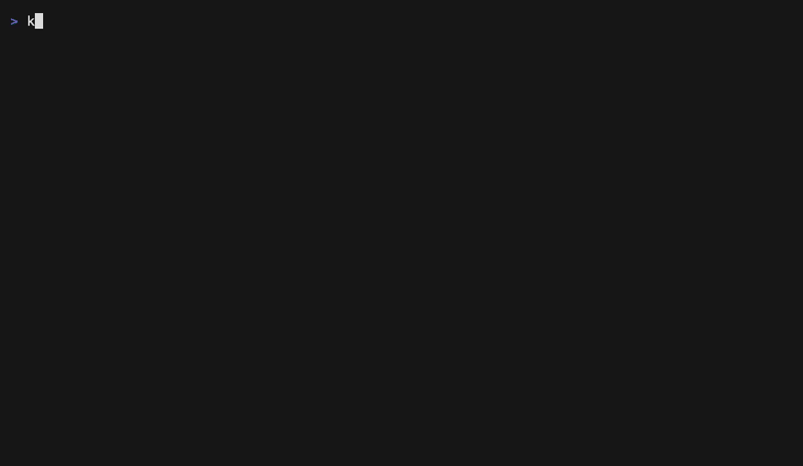
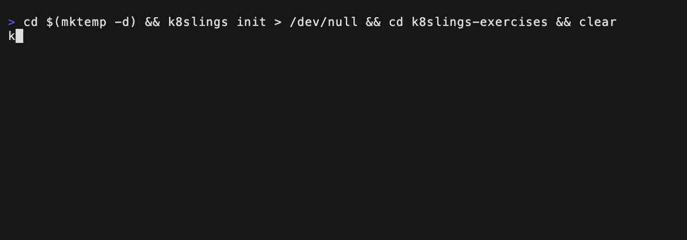

# k8slings

Learn Kubernetes by fixing small broken manifests, in the spirit of [rustlings](https://github.com/rust-lang/rustlings) and [golings](https://github.com/cleonte/golings).

You get <!-- count:exercises -->122<!-- /count --> exercises in <!-- count:topics -->22<!-- /count --> topics. Most of them need nothing but this program: your YAML is checked offline. Some run against a local cluster that k8slings creates for you, and check what really happens, and some break that cluster for you to repair.



## How it works

Each exercise is a Kubernetes manifest that is broken in one small way (the last one, in four). Edit it until `k8slings` is happy, then delete the `# I AM NOT DONE` line at the top and move on. An exercise counts as done only when its check has passed and the line is gone: deleting the line from a file that does not pass yet does not skip it. Every exercise has a short lesson, a hint, and a link to the Kubernetes documentation.

- **Manifest exercises** run offline. Your YAML is validated against the Kubernetes 1.37 schema (a misspelled `contianers:` is caught, with a message you can read) and checked with a few assertions about what you wrote.
- **Cluster exercises** are applied to a local [kind](https://kind.sigs.k8s.io/) cluster of their own and checked against what really happens: a rollout completes, a Service has endpoints, a request gets through, a network policy keeps an intruder out, a ServiceAccount may or may not delete Pods. When it does not work yet, you see the Pods and the warnings of the cluster. Without the cluster, these exercises are skipped and the rest carry on.

- **Fix exercises** break the cluster on purpose and hand you a ticket, as in a real incident: Pods that keep restarting, a Service with no endpoints. There is no file to edit. You look around and repair it with `kubectl` (`k8slings kubectl ...` is `kubectl` for the k8slings cluster), and `watch` turns green by itself when it works. Deleting the broken thing and creating a new one does not count: k8slings notices.

- **Query exercises** have you write a `kubectl` command: select Pods by label, print a table with `custom-columns`, pull a value out with `jsonpath`, sort, ask `explain`, generate YAML with `--dry-run=client`. You write one command in `answer.kubectl`, and k8slings runs it on its own cluster (read-only commands only; never in a shell) and compares what it prints with the expected output, once for the cluster as it is and once with more objects in it, so typing in today's names does not pass. Quote as you would in a POSIX shell (`-o jsonpath='{.items[*].metadata.name}'`); PowerShell quotes differently, so use single quotes as shown. A few of these need only `kubectl` and no cluster.

What you will practise: Pods, labels and selectors, namespaces, Deployments and rollouts, Services, ConfigMaps and Secrets, probes, lifecycle hooks and sidecars, requests, limits and quotas, Jobs, volumes and claims, scheduling, disruption budgets, RBAC, ServiceAccounts, network policies, and a capstone: a broken stack to debug like a real incident.

## Install

Download the archive for your system from the [releases page](https://github.com/cleonte/k8slings/releases) and put `k8slings` on your PATH, or, with Go 1.26 or newer:

```sh
go install github.com/cleonte/k8slings/k8slings@latest
```

**What you need:**

| For | You need |
|---|---|
| Manifest exercises | Nothing else. |
| Query exercises that generate YAML | `kubectl`. |
| Cluster, fix and the other query exercises | Docker (Docker Desktop, Colima, Lima with the Docker template, or Docker on Linux), [kind](https://kind.sigs.k8s.io/) v0.33.0 or newer, and `kubectl`. |

`k8slings doctor` checks all of it, says whether each half is ready, and prints the exact fix for anything that is not. One thing to know about Colima and Lima: their VMs allow too few inotify instances for a 3-node cluster by default, and `k8slings cluster up` tells you the one command that fixes it.

**On macOS**, the binaries are not signed or notarized. If you download an archive in a browser, macOS may refuse the first run ("cannot be opened because the developer cannot be verified"). Either download it with `curl`, install with `go install`, or remove the quarantine flag once: `xattr -d com.apple.quarantine k8slings`.

## Doing exercises

```sh
k8slings init            # creates k8slings-exercises/
cd k8slings-exercises
k8slings watch           # checks the first exercise that is not done yet, and again on every save
```

For the cluster exercises, create the cluster once (about two minutes the first time, and about 1.5 GB of memory):

```sh
k8slings cluster up      # one control plane and two workers; --single for one node
k8slings cluster down    # when you are done
```

The cluster is k8slings's own: it has its own kubeconfig, so your `~/.kube/config` and your current context are never touched, and k8slings never talks to any other cluster. To look around in it yourself, use `k8slings kubectl ...`, for example `k8slings kubectl get pods -A`.

| Command | What it does |
|---|---|
| `k8slings watch` | Full-screen view that re-checks the current exercise every time you save. `--plain` for plain lines. |
| `k8slings run next` / `run <name>` | Check one exercise. |
| `k8slings hint <name>` | Show the hint and a link to the Kubernetes docs. |
| `k8slings list` | All exercises, by topic, with your progress. |
| `k8slings verify` | Check every exercise in order. |
| `k8slings solution <name>` | Show the solution (hidden until you solve it; `--reveal` to look anyway). |
| `k8slings reset <name>` | Restore an exercise to its original, broken state. |
| `k8slings update` | Add the exercises of a newer version of k8slings to your folder, without touching your work. `--dry-run` to look first. |
| `k8slings cluster up` / `down` / `status` | Create, inspect and delete the local kind cluster. |
| `k8slings kubectl ...` | kubectl against the k8slings cluster only. |
| `k8slings doctor` | Check the workspace, Docker, kind, kubectl and the cluster. |

In `watch`: `h` hint, `s` solution, `r` reset, `e` open the exercise in your editor (`$VISUAL` or `$EDITOR`; for a fix exercise it opens the ticket), `n` next, `l` list, `c` check all, `q` quit.



Each exercise folder has a `README.md` with the lesson and an `exercise.yaml` to edit. Look for the `# TODO:` comment.

When an exercise is not solved, the path to edit is printed with the line of the `# TODO:` comment (`exercises/pods/pods1/exercise.yaml:8`). In the terminal of VS Code, Cmd+click (Ctrl+click on Linux and Windows) opens the file at that line.

### After you install a newer version

Your exercises folder is a copy made by the version you had when you ran `init`, so a newer k8slings does not show you its new exercises by itself. `run`, `list`, `watch` and `doctor` tell you when the folder is behind (one line, or a note in the header of the full-screen view). Then:

```sh
k8slings update --dry-run   # what would change
k8slings update
```

`update` adds the new exercises to the folder and to `info.toml`, each one where it belongs in the order of the course (`k8slings list` marks them `new`), and keeps your old `info.toml` as `info.toml.bak`. It never overwrites a file you may have worked on. READMEs are replaced with their newer text, and so is an exercise file you have not changed since k8slings wrote it; if you have changed a file that has a newer version, `update` lists it, and `k8slings reset <name>` brings the new one and loses your changes. A folder made by a version that did not have `update` yet cannot tell a changed file from an old one, so for it `update` only adds. Your progress is kept.

### When the cluster is broken for real

A fix exercise (the troubleshooting topic and the capstone) breaks the cluster on purpose, so it is easy to make it worse than it was. What to do:

- **The exercise is in a worse state than you want, or you want to start it over:** `k8slings reset <name>` breaks it again from the beginning and forgets that it was done. In `watch`, press `r`.
- **Nothing is seeded behind your back.** The first `run` or `watch` on a pending exercise sets it up (some take up to a minute, and `q` or ctrl+c stops it cleanly; the next run starts over). After that k8slings never seeds it again by itself, because that would wipe your repair. `verify` and `c` (check all) skip exercises that you have not started.
- **Done is kept.** Once an exercise has passed it stays done, even if you break the cluster again later.
- **The cluster itself is in trouble** (a node is NotReady, Pods in `kube-system` crash, `kubectl` hangs): `k8slings cluster status` and `k8slings doctor` say what is wrong and how to fix the common causes, such as the Docker inotify limits.
- **Start from a fresh cluster:** `k8slings cluster down && k8slings cluster up`. Your progress is kept (it lives in `.k8slings.json` in your exercises folder). An exercise you had started is set up again by its next `run`, since its namespace is gone.

All of this only ever touches the `k8slings` kind cluster and its own namespaces (`k8slings-<exercise>`), never the cluster in your `~/.kube/config`.

## Status

k8slings is young. The offline and cluster exercises described above work and are proven in CI on every change, including on a real kind cluster. Still to come, see the [roadmap](ROADMAP.md): more troubleshooting exercises (there is one so far), Kustomize, and exercises that need add-ons (HPA, Ingress and the Gateway API).

## Contributing

See [CONTRIBUTING.md](CONTRIBUTING.md). New exercises need a solution, and CI proves that the broken version fails and the solution passes.

## License and credits

Apache License 2.0, see [LICENSE](LICENSE) and [NOTICE](NOTICE). The structure of this project comes from [golings](https://github.com/cleonte/golings), a fork of [mauricioabreu/golings](https://github.com/mauricioabreu/golings).
